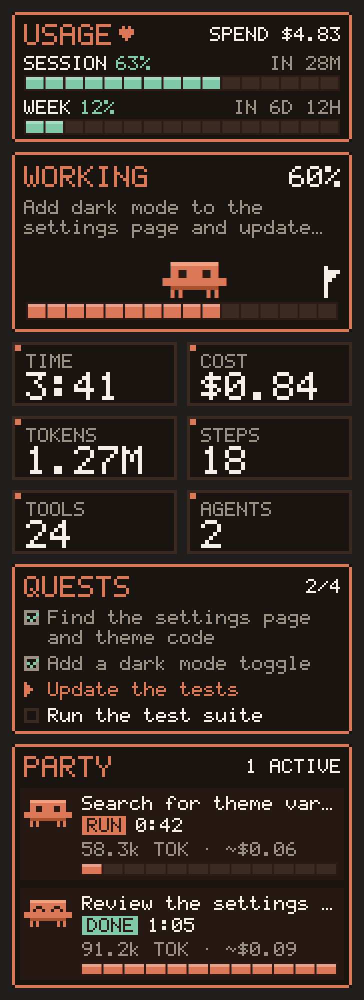

# pixel-hud

An 8-bit, Claude-themed heads-up display for Claude Code. It opens as a pane beside the chat and draws one pixel-art game screen.

<p align="center">
  
  <br><sub>Sample render of the pane mid-task (sample data)</sub>
</p>

The screen shows:

- **Usage**: your plan's 5-hour session window and weekly limit as energy bars, with time until each resets, plus the session's total spend
- **Play area**: a little pixel mascot walks a segmented progress track toward the finish flag while Claude works, then celebrates with "TASK CLEAR!"; it naps when nothing is running
- **Stats**: elapsed time, cost, tokens, model calls, tool calls and subagents (hover a box for details)
- **Quests**: Claude's task list as a pixel checklist with a done count
- **Party**: a card per subagent with its own mascot, status, time, tokens and estimated cost

Text uses a legible 5x7 pixel font. In the Claude desktop app and VS Code it draws pixel art; in the terminal it uses block characters. Type `/progress` to reopen the pane.

Task cost is the session's real spend since the prompt; each subagent's cost is an estimate split by token weight. The usage bars appear on a Claude subscription; with API billing there are no plan limits to show.

## Install

At the prompt of a Claude Code terminal session:

```
/plugin install pixel-hud --marketplace reymonmercado/pixel-hud
```

Answer `y` to add the marketplace, then pick a scope (user is first).

From a shell:

```bash
claude plugin install pixel-hud --marketplace reymonmercado/pixel-hud
```

In the desktop app, where `/plugin` does not run: click **+** next to the prompt box, then **Plugins**, **Add marketplace** with `reymonmercado/pixel-hud`, then **Add plugin**.
